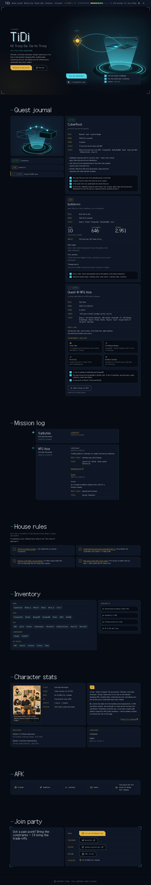

# TiDi · portfolio

My personal portfolio, in an RPG game style: a HUD, a quest journal, a character sheet and a live 3D hologram hero.

This repo is my playground. I built it in my leisure time, and **AI built all of it**. I wrote the brief, answered questions, picked options and gave feedback. [Claude Code](https://claude.com/claude-code) wrote every line of code and every doc, working as a small team of agents.



## Stack

Next.js 16 · React 19 · TypeScript · Tailwind CSS 4 · React Three Fiber (Three.js) · Zod · Tabler icons · Galmuri11 pixel font

The site is a static page. The 3D scenes load as client islands and fall back to posters when WebGL isn't available. Every animation has a reduced-motion variant.

## The AI team

| Who | Job |
|---|---|
| Main session | Talks to me, runs the interview, writes briefs, makes rulings, keeps `docs/progress.md` |
| `design-lead` | Design directions, `DESIGN.md`, design critiques |
| `frontend-engineer` | Architecture and all the code |
| `qa-reviewer` | Independent code reviews, UI and accessibility audits, content checks |

Skills (in `.claude/skills/`): portfolio-content, design-direction, design-system, implementation-plan, frontend-build, ui-audit, code-review, verification.

The rules everyone follows are in [`CLAUDE.md`](CLAUDE.md).

## How it was built, from scratch

1. **Brief:** [`prompt.md`](prompt.md), plus reference lists for UI ([`ui-ref.md`](ui-ref.md)) and agent workflows ([`skill-ref.md`](skill-ref.md)).
2. **System:** analyse the references, then write the skills, the agents and `CLAUDE.md` ([`docs/reference-analysis.md`](docs/reference-analysis.md)).
3. **Interview:** the AI asked me questions. My confirmed answers became [`info.md`](info.md), the only source of facts about me.
4. **Directions:** `design-lead` proposed 3 visual directions with live previews, and I picked one.
5. **Design system:** [`DESIGN.md`](DESIGN.md), covering tokens, type, components and motion.
6. **Plan:** all three agents contributed to a phased plan, which I approved ([`docs/plan/v2/`](docs/plan/v2/implementation-plan.md)).
7. **Build:** `frontend-engineer` built it phase by phase: foundation → hero and handshake → quest journal → other sections → résumé PDF.
8. **Review and fix:** QA and design reviews, then fix rounds ([`docs/reviews/`](docs/reviews/), [`docs/reports/`](docs/reports/)).

The first version was too plain, so I threw away all its code and the AI started over as v2, the "Holo Deck" design. Later I asked for a more RPG-style font, and the whole site switched to pixel type. The full decision log is in [`docs/progress.md`](docs/progress.md).

## Run it

Requires Node 24 (`.nvmrc`) and pnpm.

```sh
pnpm install
pnpm dev          # http://localhost:3000
pnpm check        # design lint, token/font/résumé sync, lint, typecheck
pnpm build        # static production build
pnpm resume:pdf   # regenerate public/tidi-resume.pdf from the content
```

Content lives in `src/content/` and mirrors `info.md`.
